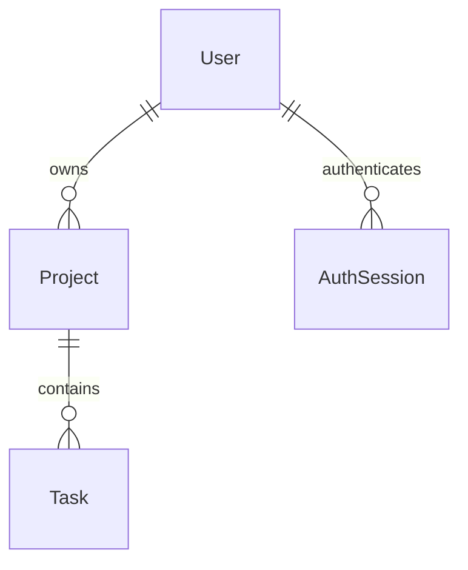

# B6-3: 로그인이 되고 회원끼리 연결되는 웹 서비스 만들기

B6-2의 할 일 앱을 확장해 회원별 프로젝트와 할 일을 관리합니다. 로그인한 회원은 프로젝트 안에 할 일을 작성하고 완료/진행 중 상태를 변경합니다.

## 실행 방법

Python 3.10 이상을 사용합니다.

```bash
python3 -m venv .venv
source .venv/bin/activate
python -m pip install -r requirements.txt
uvicorn app:app --host 127.0.0.1 --port 8001
```

http://localhost:8001 을 엽니다. DB 파일은 프로젝트 루트의 task.db입니다. B6-2의 DB를 그대로 복사하지 않고 새 관계 스키마로 생성합니다.

## 테스트 계정

| ID | PW |
|---|---|
| demo | practice1234 |
| guest | practice1234 |

처음 실행할 때 테스트 회원을 DB에 생성합니다. 신규 계정의 비밀번호는 무작위 salt를 사용하는 bcrypt cost 12 해시로 저장합니다. 이 계정은 로컬 실습용입니다.

## 인증 방식

서버 DB 세션 방식을 사용합니다. 로그인 성공 시 무작위 세션 토큰을 HttpOnly, SameSite=Lax 쿠키에 발급하고 서버에는 토큰의 SHA-256 해시와 만료 시각을 저장합니다. 로그아웃하면 서버의 세션을 삭제합니다. 외부 서비스나 토큰 발급 계정은 필요하지 않습니다.

## 실행 환경

```bash
$ python3 --version
Python 3.14.7
```

B6-2의 소스와 고정된 패키지 버전을 기반으로 별도 제출 저장소에서 확장합니다.

## 패키지 설치

```bash
Resolved 18 packages in 58ms
Installed 18 packages in 76ms
 + annotated-doc==0.0.5
 + annotated-types==0.8.0
 + anyio==4.15.1
 + click==8.5.0
 + fastapi==0.142.2
 + h11==0.16.0
 + idna==3.20
 + jinja2==3.1.6
 + markupsafe==3.0.3
 + opentelemetry-api==1.45.0
 + pydantic==2.13.5
 + pydantic-core==2.46.5
 + python-multipart==0.0.32
 + sqlalchemy==2.1.1
 + starlette==1.7.0
 + typing-extensions==4.16.0
 + typing-inspection==0.4.4
 + uvicorn==0.54.0
```

B6-2와 같은 고정 버전의 허용 패키지를 설치했습니다. 인증 토큰은 Python 표준 라이브러리로 발급하며, 보너스에서 bcrypt 5.0.0을 추가했습니다.

## 인증과 관계 검증

```bash
$ .venv/bin/python -W error::ResourceWarning -m unittest discover -s tests -v
test_anonymous_and_wrong_password (testweb.WebTests.test_anonymous_and_wrong_password) ... ok
test_complete_workflow_relations_and_idempotent_state (testweb.WebTests.test_complete_workflow_relations_and_idempotent_state) ... ok
test_csrf_validation_missing_and_escaped_content (testweb.WebTests.test_csrf_validation_missing_and_escaped_content) ... ok
test_expired_session_and_project_cascade (testweb.WebTests.test_expired_session_and_project_cascade) ... ok
test_login_ui_cookie_and_hashed_storage (testweb.WebTests.test_login_ui_cookie_and_hashed_storage) ... ok
test_logout_revokes_replayed_cookie_and_session_rotation (testweb.WebTests.test_logout_revokes_replayed_cookie_and_session_rotation) ... ok
test_other_member_cannot_read_or_change (testweb.WebTests.test_other_member_cannot_read_or_change) ... ok
test_relations_persist_after_restart (testweb.WebTests.test_relations_persist_after_restart) ... ok

----------------------------------------------------------------------
Ran 8 tests in 2.967s

OK
```

비로그인 차단, 로그인 실패와 UI, 세션 해시 저장, 소유권, CSRF, 상태 변경, 세션 회전과 로그아웃 폐기, 만료, cascade 삭제와 서버 재시작 후 관계 저장을 검사했습니다. 세션 쿠키 값은 출력하지 않습니다.

## 로그인부터 완료 상태 변경까지

```bash
GET /app/projects: 303 Location=/login
POST /login (wrong password): 400
POST /login (demo): 303 Location=/app/projects
Set-Cookie: session=[masked]; HttpOnly; Max-Age=3600; Path=/; SameSite=lax
POST /app/projects: 303 Location=/app/projects/1
POST /app/projects/1/tasks: 303 Location=/app/tasks/1
Before: 진행 중
POST /app/tasks/1/state: 303
After: 완료
GET /app/projects/1: 200
SQLite user/project/task: [('demo', '학습 계획', '미션 검토', 1)]
POST /logout: 303
GET /app/projects after logout: 303
```

로그인 후 프로젝트와 할 일을 생성하고 진행 중 상태를 완료로 바꿨습니다. 마지막 SQLite 조회는 회원, 프로젝트, 할 일의 FK를 JOIN한 결과입니다. Set-Cookie의 세션 값은 마스킹했습니다.

## 패키지와 경로 정책

Python 3.14.7, FastAPI 0.142.2, Uvicorn 0.54.0, SQLAlchemy 2.1.1, Jinja2 3.1.6, python-multipart 0.0.32, bcrypt 5.0.0에서 실행했습니다. requirements.txt에 주요 패키지 버전을 고정했습니다.

| 경로 | 공개/보호 | 기능 |
|---|---|---|
| GET / | 공개 | 로그인 상태에 따라 메뉴 변경 |
| GET/POST /login | 공개 | 로그인 폼과 세션 발급 |
| GET/POST /signup | 공개 | CSRF 확인 후 회원가입 |
| POST /logout | 보호 | 세션 폐기 |
| GET /app/projects | 보호 | 회원의 프로젝트 목록 |
| GET /app/projects/new | 보호 | 프로젝트 등록 폼 |
| POST /app/projects | 보호 | 프로젝트 생성 |
| GET /app/projects/{id} | 보호 | 소유 회원과 연결된 할 일 표시 |
| POST /app/projects/{id}/delete | 보호 | 프로젝트와 하위 할 일 삭제 |
| GET /app/projects/{id}/tasks/new | 보호 | 할 일 등록 폼 |
| POST /app/projects/{id}/tasks | 보호 | 할 일 생성 |
| GET /app/tasks | 보호 | 회원의 모든 할 일 목록 |
| GET /app/tasks/{id} | 보호 | 상세와 상태 표시 |
| GET/POST /app/tasks/{id}/edit | 보호 | 수정 폼과 저장 |
| POST /app/tasks/{id}/state | 보호 | 진행 중/완료 전환 |
| POST /app/tasks/{id}/delete | 보호 | 할 일 삭제 |

모든 보호 경로는 Depends(require_session) 또는 Depends(require_csrf)를 사용합니다. 쿠키를 확인한 optional_session이 DB에서 세션과 만료 시각을 조회하고 AuthContext를 반환합니다. 세션이 없으면 require_session에서 중단하고 로그인 화면으로 303 이동합니다. 변경 요청은 로그인 세션의 CSRF 값도 비교합니다. 단순히 UI 링크를 숨기는 것과 서버에서 접근을 막는 것은 다릅니다.

세션은 1시간 유지되며 로그인 때 토큰을 새로 생성하고 기존 토큰을 폐기합니다. 로그아웃 후 과거 쿠키를 재전송해도 DB 세션이 없어 접근할 수 없습니다. 로컬 HTTP 실습이므로 쿠키의 Secure 속성은 설정하지 않았습니다. 외부 HTTPS로 배포할 때는 Secure를 적용하고 테스트 계정을 제거해야 합니다.

## 관계와 상태 변경

User와 Project는 1:N, Project와 Task는 1:N입니다. relationship/back_populates로 양방향을 연결했습니다. 프로젝트 상세에는 Project.owner.username과 Project.tasks를 함께 출력하고, 할 일 상세에는 Task.project의 이름을 표시합니다. 부모 삭제 정책은 프로젝트에 속한 작업을 함께 삭제하는 cascade이며 이유는 모델 주석에 있습니다.



세 도메인 모델과 별도로 AuthSession은 인증 상태를 보관합니다. 모든 핵심 데이터와 관계, 세션은 SQLite에 저장합니다. 다른 회원의 id를 알아도 TaskService의 소유권 검사에서 데이터가 없는 것과 같은 404로 처리합니다.

완료 상태는 TaskService.set_completed에서 변경합니다. 입력을 true/false로 고정하고 명시한 상태를 저장하므로 같은 요청을 두 번 보내도 상태가 다시 뒤집히지 않습니다. 저장 후 상세로 303 이동해 상태를 표시합니다. 라우터는 요청과 화면 전환, 서비스는 소유권과 상태 정책, 저장소는 SQLAlchemy Session 접근을 담당합니다.

사용자는 로그인, 프로젝트 등록, 할 일 등록, 상세 확인, 완료 전환 순서로 이용합니다. 개발자 관점에서는 Cookie/Form, Depends의 세션 검사, 서비스 검증, Repository의 DB 저장, TemplateResponse와 RedirectResponse로 이어집니다.

기본 미션에서 사용한 기존 비밀번호는 [Python hashlib](https://docs.python.org/3/library/hashlib.html#hashlib.pbkdf2_hmac)의 PBKDF2-HMAC-SHA256에 16바이트 무작위 salt와 600,000회 반복을 적용했습니다. 세션 토큰은 무작위로 발급하고 인증 조회용 해시만 저장하므로 비밀번호 해시의 느린 검증과 별도로 처리합니다.

검사는 다음과 같이 실행합니다.

```bash
python -m unittest discover -s tests -v
```

## 로그인 실패 화면의 기존 세션

```bash
$ .venv/bin/python -W error::ResourceWarning -m unittest discover -s tests -v
test_anonymous_and_wrong_password (testweb.WebTests.test_anonymous_and_wrong_password) ... ok
test_complete_workflow_relations_and_idempotent_state (testweb.WebTests.test_complete_workflow_relations_and_idempotent_state) ... ok
test_csrf_validation_missing_and_escaped_content (testweb.WebTests.test_csrf_validation_missing_and_escaped_content) ... ok
test_expired_session_and_project_cascade (testweb.WebTests.test_expired_session_and_project_cascade) ... ok
test_login_ui_cookie_and_hashed_storage (testweb.WebTests.test_login_ui_cookie_and_hashed_storage) ... ok
test_logout_revokes_replayed_cookie_and_session_rotation (testweb.WebTests.test_logout_revokes_replayed_cookie_and_session_rotation) ... ok
test_other_member_cannot_read_or_change (testweb.WebTests.test_other_member_cannot_read_or_change) ... ok
test_relations_persist_after_restart (testweb.WebTests.test_relations_persist_after_restart) ... ok

----------------------------------------------------------------------
Ran 8 tests in 3.929s

OK
```

이미 로그인한 상태에서 다른 로그인에 실패해도 기존 세션은 유효합니다. 오류 화면도 해당 회원의 메뉴를 유지하도록 수정하고 검사했습니다.

## 보너스: 회원가입과 검색/필터

```bash
$ .venv/bin/python -W error::ResourceWarning -m unittest discover -s tests -v
test_anonymous_and_wrong_password (testweb.WebTests.test_anonymous_and_wrong_password) ... ok
test_complete_workflow_relations_and_idempotent_state (testweb.WebTests.test_complete_workflow_relations_and_idempotent_state) ... ok
test_csrf_validation_missing_and_escaped_content (testweb.WebTests.test_csrf_validation_missing_and_escaped_content) ... ok
test_expired_session_and_project_cascade (testweb.WebTests.test_expired_session_and_project_cascade) ... ok
test_login_ui_cookie_and_hashed_storage (testweb.WebTests.test_login_ui_cookie_and_hashed_storage) ... ok
test_logout_revokes_replayed_cookie_and_session_rotation (testweb.WebTests.test_logout_revokes_replayed_cookie_and_session_rotation) ... ok
test_other_member_cannot_read_or_change (testweb.WebTests.test_other_member_cannot_read_or_change) ... ok
test_relations_persist_after_restart (testweb.WebTests.test_relations_persist_after_restart) ... ok
test_search_filters_and_member_isolation (testweb.WebTests.test_search_filters_and_member_isolation) ... ok
test_signup_hash_duplicate_csrf_and_login (testweb.WebTests.test_signup_hash_duplicate_csrf_and_login) ... ok
test_signup_validation_utf8_limit_and_legacy_password (testweb.WebTests.test_signup_validation_utf8_limit_and_legacy_password) ... ok

----------------------------------------------------------------------
Ran 11 tests in 6.982s

OK
```

GET /signup에서 회원가입 폼을 열고 POST /signup 후 /login으로 이동합니다. ID는 소문자로 정규화한 3~40자 영문/숫자/._-이며 중복을 차단합니다. 비밀번호는 8자 이상이면서 UTF-8 72바이트 이내이며, bcrypt 5.0.0의 cost 12로 해싱합니다. 기존 PBKDF2 해시는 로그인 검증을 유지합니다. 가입 폼의 쿠키와 토큰을 비교하여 CSRF를 확인하고 비밀번호는 오류 화면에 돌려주지 않습니다. /app/tasks?q=&completed=true|false&project_id=에서 제목/상태/프로젝트를 함께 검색합니다. 검색 쿼리에도 회원 ID를 적용하여 타인의 할 일을 노출하지 않습니다. 빈 프로젝트 값은 전체이며 타인 프로젝트 ID는 404입니다. 실제 HTTP 검사 11개에서 회원가입/로그인, 중복/길이/CSRF, 권한 경계와 기존 흐름을 확인했습니다. bcrypt 사용법: https://github.com/pyca/bcrypt . OAuth2 소셜 로그인과 외부 클라우드 배포는 외부 앱/배포 계정 설정을 기다리고 있습니다.

## 잘못된 CSRF 문자열 재현

가입 폼과 인증 후 프로젝트 등록에 비ASCII CSRF 값을 전송하면 요청 거부 대신 서버 오류가 발생했습니다. [hmac.compare_digest](https://docs.python.org/3/library/hmac.html#hmac.compare_digest)의 문자열 비교는 ASCII 입력을 요구합니다. 유효한 토큰은 URL-safe ASCII로 생성되지만 잘못된 폼 값을 비교 전에 검증하지 않았습니다.

```text
$ .venv/bin/python -W error::ResourceWarning -m unittest discover -s tests -k non_ascii_csrf -v
test_non_ascii_csrf_is_rejected_without_server_error (testweb.WebTests.test_non_ascii_csrf_is_rejected_without_server_error) ... 
  test_non_ascii_csrf_is_rejected_without_server_error (testweb.WebTests.test_non_ascii_csrf_is_rejected_without_server_error) (route='signup') ... FAIL
  test_non_ascii_csrf_is_rejected_without_server_error (testweb.WebTests.test_non_ascii_csrf_is_rejected_without_server_error) (route='authenticated-action') ... FAIL

======================================================================
FAIL: test_non_ascii_csrf_is_rejected_without_server_error (testweb.WebTests.test_non_ascii_csrf_is_rejected_without_server_error) (route='signup')
----------------------------------------------------------------------
Traceback (most recent call last):
  File "/Users/yejun/GitHub/Codyssey/B6/B6-3/submission/tests/testweb.py", line 247, in test_non_ascii_csrf_is_rejected_without_server_error
    self.assertEqual(status, 403)
    ~~~~~~~~~~~~~~~~^^^^^^^^^^^^^
AssertionError: 500 != 403

======================================================================
FAIL: test_non_ascii_csrf_is_rejected_without_server_error (testweb.WebTests.test_non_ascii_csrf_is_rejected_without_server_error) (route='authenticated-action')
----------------------------------------------------------------------
Traceback (most recent call last):
  File "/Users/yejun/GitHub/Codyssey/B6/B6-3/submission/tests/testweb.py", line 251, in test_non_ascii_csrf_is_rejected_without_server_error
    self.assertEqual(status, 403)
    ~~~~~~~~~~~~~~~~^^^^^^^^^^^^^
AssertionError: 500 != 403

----------------------------------------------------------------------
Ran 1 test in 1.234s

FAILED (failures=2)

```

## CSRF 입력 검증 수정

비ASCII 입력은 hmac.compare_digest 호출 전에 거절하도록 가입 폼과 require_csrf에 ASCII 검사를 추가했습니다. 두 요청 모두 HTTP403으로 처리되며 세션/가입/검색/기존 CRUD를 포함한 검사 12개가 통과했습니다.

```text
$ .venv/bin/python -W error::ResourceWarning -m unittest discover -s tests -v
test_anonymous_and_wrong_password (testweb.WebTests.test_anonymous_and_wrong_password) ... ok
test_complete_workflow_relations_and_idempotent_state (testweb.WebTests.test_complete_workflow_relations_and_idempotent_state) ... ok
test_csrf_validation_missing_and_escaped_content (testweb.WebTests.test_csrf_validation_missing_and_escaped_content) ... ok
test_expired_session_and_project_cascade (testweb.WebTests.test_expired_session_and_project_cascade) ... ok
test_login_ui_cookie_and_hashed_storage (testweb.WebTests.test_login_ui_cookie_and_hashed_storage) ... ok
test_logout_revokes_replayed_cookie_and_session_rotation (testweb.WebTests.test_logout_revokes_replayed_cookie_and_session_rotation) ... ok
test_non_ascii_csrf_is_rejected_without_server_error (testweb.WebTests.test_non_ascii_csrf_is_rejected_without_server_error) ... ok
test_other_member_cannot_read_or_change (testweb.WebTests.test_other_member_cannot_read_or_change) ... ok
test_relations_persist_after_restart (testweb.WebTests.test_relations_persist_after_restart) ... ok
test_search_filters_and_member_isolation (testweb.WebTests.test_search_filters_and_member_isolation) ... ok
test_signup_hash_duplicate_csrf_and_login (testweb.WebTests.test_signup_hash_duplicate_csrf_and_login) ... ok
test_signup_validation_utf8_limit_and_legacy_password (testweb.WebTests.test_signup_validation_utf8_limit_and_legacy_password) ... ok

----------------------------------------------------------------------
Ran 12 tests in 6.085s

OK

```
